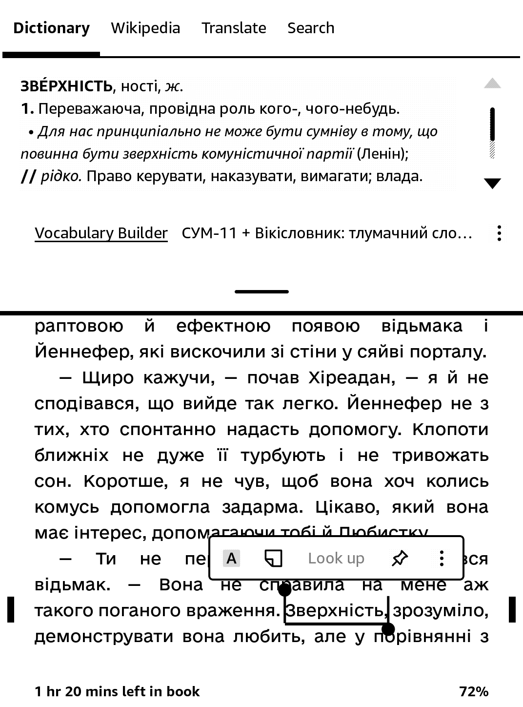
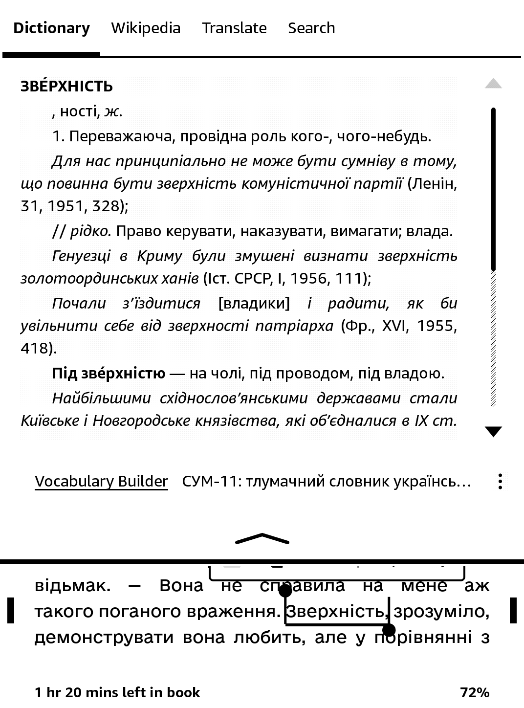
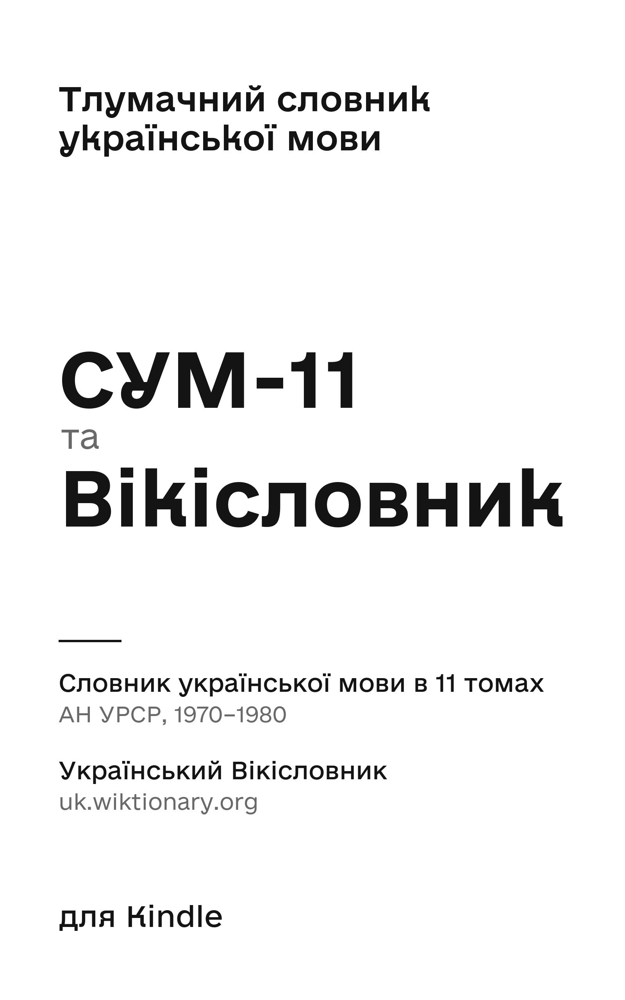
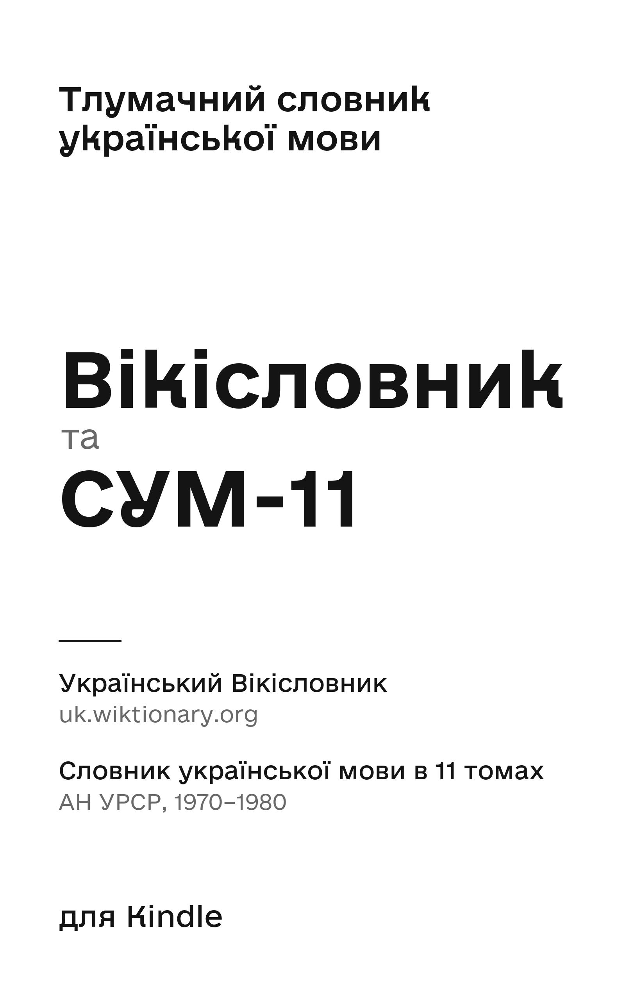
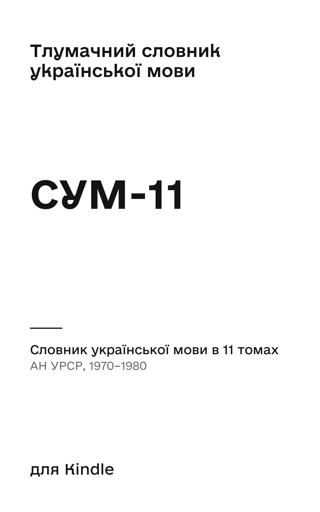
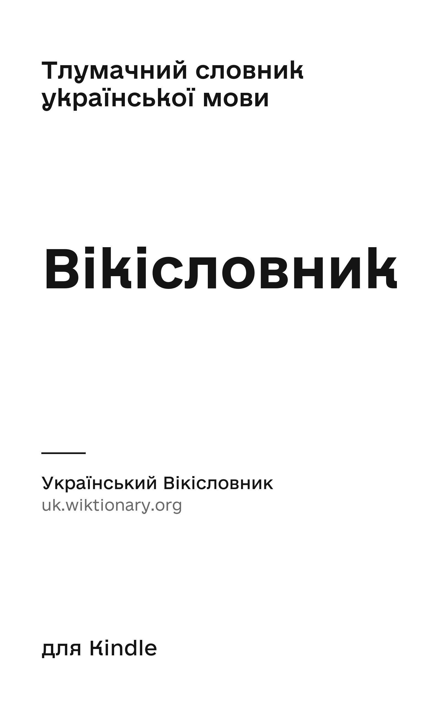

<div align="center">

# 📖 Тлумачний словник української мови для Kindle

**СУМ-11** (АН УРСР · 1970–1980) **+ Український Вікісловник**

Просто утримуйте палець на слові в українській книжці, і Kindle покаже його значення.

[](../../releases/latest)
[](../../releases)
[](LICENSE)
[](https://creativecommons.org/licenses/by-sa/4.0/deed.uk)


**[⬇️ Завантажити](../../releases/latest)** &nbsp;·&nbsp;
**[Який обрати](#choose)** &nbsp;·&nbsp;
**[Встановлення](#install)** &nbsp;·&nbsp;
**[Оновлення](#update)** &nbsp;·&nbsp;
**[Питання](#faq)** &nbsp;·&nbsp;
**[Зібрати самому](#build)** &nbsp;·&nbsp;
**[English](README_EN.md)**

</div>

---

## Можливості

- 📚 **До 139 тис. статей**: академічний СУМ-11 з прикладами вживання, сучасніший Вікісловник і 1,4 тис. коротких тлумачень від Claude (ШІ) для слів, яких бракує в обох
- 🆕 **Новіші слова**: «інтернет», «гаджет», «процесор», «нейромережа», «ШІ», а також «проти», «прямо», «пташка», «ґрунт», «п’ять», яких бракує в даних СУМ-11
- 🔤 **Будь-яка форма слова**: «абажуром», «писала», «кажучи», «найменшого» відкривають «абажур», «писати», «казати», «менший» (≈4 млн форм)
- 🎯 **Потрібне слово**: «мені» відкриває «я», а не «мень», «голові» — «голова», а не «гол»
- 🔠 **Початок речення**: «Ганком» з великої літери теж знаходиться
- 🇺🇦 **«ґ» і «г»**: «ґанок» знаходиться і в старому написанні «ганок», і навпаки
- ’ **Будь-який апостроф**: ’ &nbsp;'&nbsp; ʼ
- 🪟 **Зручне спливне вікно**: граматика в рядку із заголовком, номери значень жирним, приклади дрібніше й з відступом

<table>
  <tr>
    <td align="center" width="50%"></td>
    <td align="center" width="50%"></td>
  </tr>
  <tr>
    <td align="center"><sub>Утримали палець на слові «Зверхність» на початку речення</sub></td>
    <td align="center"><sub>Розгорнута стаття: значення, приклади з відступом, автори цитат</sub></td>
  </tr>
</table>

<a id="choose"></a>
## Який словник обрати

На сторінці [Releases](../../releases/latest) є чотири файли. Достатньо одного.

<table>
  <tr>
    <td align="center" width="25%"><a href="https://github.com/volkovskey/kindle-sum11-dictionary/releases/latest/download/sum11-wiktionary.mobi"></a><br><sub>⭐ <a href="https://github.com/volkovskey/kindle-sum11-dictionary/releases/latest/download/sum11-wiktionary.mobi"><code>sum11-wiktionary.mobi</code></a></sub></td>
    <td align="center" width="25%"><a href="https://github.com/volkovskey/kindle-sum11-dictionary/releases/latest/download/wiktionary-sum11.mobi"></a><br><sub><a href="https://github.com/volkovskey/kindle-sum11-dictionary/releases/latest/download/wiktionary-sum11.mobi"><code>wiktionary-sum11.mobi</code></a></sub></td>
    <td align="center" width="25%"><a href="https://github.com/volkovskey/kindle-sum11-dictionary/releases/latest/download/sum11.mobi"></a><br><sub><a href="https://github.com/volkovskey/kindle-sum11-dictionary/releases/latest/download/sum11.mobi"><code>sum11.mobi</code></a></sub></td>
    <td align="center" width="25%"><a href="https://github.com/volkovskey/kindle-sum11-dictionary/releases/latest/download/wiktionary.mobi"></a><br><sub><a href="https://github.com/volkovskey/kindle-sum11-dictionary/releases/latest/download/wiktionary.mobi"><code>wiktionary.mobi</code></a></sub></td>
  </tr>
</table>

| | Файл | Статей | Розмір | Що всередині |
|:--:|:--|--:|--:|:--|
| ⭐ | **`sum11-wiktionary.mobi`** | 139&nbsp;422 | 198&nbsp;МБ | **СУМ-11, доповнений Вікісловником.** Спершу академічні тлумачення СУМ-11 (131 тис. статей), а для слів, яких у СУМ-11 немає, — Вікісловник (7 тис.) |
| | `wiktionary-sum11.mobi` | 139&nbsp;400 | 192&nbsp;МБ | **Вікісловник, доповнений СУМ-11.** Слово шукається спершу у Вікісловнику (18 тис. статей), а якщо його там немає — у СУМ-11 (120 тис.) |
| | `sum11.mobi` | 131&nbsp;155 | 187&nbsp;МБ | **Лише СУМ-11** |
| | `wiktionary.mobi` | 19&nbsp;915 | 19&nbsp;МБ | **Лише Вікісловник.** Сучасніший, але вшестеро менший |

**Чому рекомендований саме перший.** СУМ-11 рівний за якістю: докладні
тлумачення, відтінки значень і приклади з художньої літератури. Саме це
потрібно для слів, які зазвичай виділяють у книжці: рідкісних, застарілих,
діалектних. Вікісловник нерівний: поруч із добрими статтями багато коротких, без
прикладів. Тож він лише доповнює СУМ-11 новими словами («інтернет», «гаджет») і
тими, яких бракує в даних СУМ-11 («ґрунт», «ґудзик», «п’ять»).

**Коли краще `wiktionary-sum11.mobi`.** Якщо важливіші сучасні тлумачення, ніж
докладність: для слів, що є у Вікісловнику, ви не побачите радянських
формулювань СУМ-11 («буржуазний», «націоналізм» тощо). Статті Вікісловника, що
лише відсилають до іншого слова («жін. до *абітурієнт*», «те саме, що
*ґанок*»), і тут замінюються повною статтею СУМ-11: у спливному вікні за
відсилкою не перейдеш.

У змішаних словниках кожна стаття закінчується підписом **— Вікісловник** або
**— СУМ-11**, тож завжди видно, звідки тлумачення.

> 🤖 **Тлумачення від Claude (ШІ)**
>
> Для ~1,4 тис. слів, яких немає ні в СУМ-11, ні у Вікісловнику, короткі
> тлумачення написав Claude (ШІ від Anthropic): частково це пропущені в даних
> СУМ-11 слова («проти», «прямо», «пташка», «занадто», «обов’язок»), частково
> сучасна лексика («процесор», «нейромережа», «ШІ», «застосунок»). Такі статті є
> лише в змішаних словниках, підписані **— Claude (ШІ)** і можуть містити
> помилки, особливо в наголосах рідкісних слів. Усі вони лежать у
> [`claude.tsv`](claude.tsv): якщо помітили помилку, відкрийте
> [issue](../../issues).

> 💡 **Порада**
>
> Можна поставити кілька словників одразу й перемикатися між ними у спливному
> вікні: **⋮ → Change Dictionary**.

<a id="install"></a>
## Встановлення

**1. Завантажте** один із файлів (рекомендований — `sum11-wiktionary.mobi`) зі
сторінки **[Releases](../../releases/latest)**.

**2. Скопіюйте файл у папку `documents/dictionaries` на Kindle.** Спосіб залежить від моделі та комп'ютера:

| Kindle | Комп'ютер | Як скопіювати |
|:--|:--|:--|
| Моделі до 2024 року | Windows · macOS · Linux | Kindle з'являється як звичайна флешка |
| Моделі 2024 року й новіші, Kindle Scribe | Windows | Kindle видно в Провіднику |
| Моделі 2024 року й новіші, Kindle Scribe | macOS | **[Send to Kindle для Mac](https://www.amazon.com/sendtokindle)** → меню **Tools → USB File Manager** |

> ⚠️ **Увага**
>
> Потрібна саме передача **по кабелю**. Бездротова відправка через Send to Kindle
> (кнопка «Send», e-mail, застосунок на телефоні) не підійде: `.mobi` вона з
> грудня 2023 року не приймає, а файл потрапив би в документи, а не в словники.

**3. Від'єднайте Kindle** безпечно. Через хвилину-дві словник з'явиться в бібліотеці.

**4. Один раз відкрийте сам словник** з бібліотеки, як звичайну книжку, і
закрийте його.

> ❗ **Важливо**
>
> Без цього кроку деякі Kindle при виділенні слова пишуть, що визначення не
> знайдено, хоча словник уже скопійовано. Після першого відкриття все працює.

**5. Відкрийте українську книжку й утримуйте палець на слові.** Якщо у спливному
вікні відкрився інший словник, торкніться **⋮** (три крапки праворуч унизу
вікна) → **Change Dictionary** й оберіть потрібний:

| Файл | Назва в списку словників |
|:--|:--|
| `sum11-wiktionary.mobi` | СУМ-11 + Вікісловник |
| `wiktionary-sum11.mobi` | Вікісловник + СУМ-11 |
| `sum11.mobi` | СУМ-11 |
| `wiktionary.mobi` | Вікісловник |

Kindle запам'ятає вибір.

> 💡 **Порада**
>
> **Пошук по словнику вручну.** Української клавіатури на Kindle немає. Можна
> додати російську (Settings → Language & Dictionaries → Keyboards) і набирати
> нею слова без і, ї, є, ґ. Головний сценарій, пошук слова з книжки, працює
> повністю.

<a id="update"></a>
## Оновлення до нової версії

Новий файл має ту саму назву, але просто скопіювати його поверх старого
недостатньо: Kindle тримає поруч зі словником папку `.sdr` зі своїми даними про
нього. Її треба видалити разом зі старим файлом, щоб нічого не лишилося від
попередньої версії.

**1. Підключіть Kindle** до комп'ютера кабелем, так само як при встановленні
(крок 2 [встановлення](#install)).

**2. Видаліть у папці `documents/dictionaries` старий словник разом із його
папкою `.sdr`.** Наприклад, для рекомендованого:

```
documents/dictionaries/sum11-wiktionary.mobi   ← видалити
documents/dictionaries/sum11-wiktionary.sdr/   ← видалити
```

Інших словників і файлів не чіпайте.

**3. Встановіть нову версію** за [інструкцією](#install), з кроку 1: завантажте,
скопіюйте, від'єднайте Kindle й один раз відкрийте словник.

<a id="faq"></a>
## Часті питання

<details>
<summary><b>«Не знайдено визначення» — чому?</b></summary>
<br>

| Причина | Що робити |
|:--|:--|
| **У книжці вказана не та мова.** Kindle зазвичай обирає словник за мовою з метаданих книжки, і для книжки, позначеної як російська чи англійська, відкриває інший словник | Оберіть словник у спливному вікні вручну або виправте мову книжки, наприклад у [Calibre](https://calibre-ebook.com/) |
| **Слова немає в словнику.** СУМ-11 укладено в 1970–1980 роках, Вікісловник ще малий: частини новітньої лексики, сленгу й власних назв немає в жодному | Спробуйте змішаний словник, якщо стоїть лише один із двох |
| **Слова немає в даних, з яких зібрано словник** | Див. [Відомі обмеження](#limits) |
| **Рідкісна форма слова.** Форми генерує pymorphy3; якщо він не знає слова, статтю відкриє лише початкова форма | Шукайте початкову форму |
| **Словник щойно скопійовано й ще жодного разу не відкривався** | Відкрийте словник один раз з бібліотеки (крок 4 [встановлення](#install)); перевірте, що файл лежить саме в `documents/dictionaries` |

</details>

<details>
<summary><b>Слово може бути формою двох різних слів. Яке відкриється?</b></summary>
<br>

Статті з однаковим заголовком (як «рентген» і «рентген…») зібрано в одну, тож
у спливному вікні видно всі. Якщо ж форма належить двом різним словам, Kindle
відкриває лише одне. Словник віддає таку форму слову, яке частіше трапляється
у тексті самого словника, здебільшого в цитатах: «мені» відкриває «я», а не «мень», «голові» —
«голова», а не «гол». Зрідка вибір не збігається з контекстом («сходами» веде
до «схід», а не до «сходи»): тоді шукайте початкову форму в повному словнику.

</details>

<details>
<summary><b>Чому у Вікісловнику немає імен, прізвищ і назв сіл?</b></summary>
<br>

Їх свідомо прибрано: таких статей там тисячі, і вони заважали б пошуку. Kindle
спершу шукає точне написання, тож «Щастя» на початку речення відкрило б статтю
про місто Щастя, а не слово «щастя». Лишилися назви країн, великих міст тощо,
якщо вони не збігаються зі звичайним словом.

</details>

<details>
<summary><b>Чи можна відправити словник через Send to Kindle без кабелю?</b></summary>
<br>

Ні. Бездротова відправка не приймає `.mobi` і кладе файли в документи, а Kindle
розпізнає словник лише в папці `documents/dictionaries`. На Mac для новіших
моделей використовуйте USB File Manager у тому ж застосунку
[Send to Kindle](https://www.amazon.com/sendtokindle).

</details>

<a id="build"></a>
## Як зібрати самому

Потрібні macOS або Linux (на Windows — WSL), `python3`, `curl` і `unzip`.

```sh
git clone https://github.com/volkovskey/kindle-sum11-dictionary
cd kindle-sum11-dictionary
./build.sh                  # усі чотири варіанти → dist/*.mobi
MODE=wiki+sum11 ./build.sh  # один варіант: sum11 | wiki | sum11+wiki | wiki+sum11
NO_INFL=1 ./build.sh        # лише головні слова, без форм → dist/*-plain.mobi
```

<details>
<summary>Що робить <code>build.sh</code></summary>
<br>

1. Завантажує в `work/` tab-файл СУМ-11 і свіжий дамп українського Вікісловника
   (інший дамп можна вказати через `WIKI_URL`).
2. Ставить залежності з `requirements.txt` у `.venv`.
3. Генерує OPF і HTML скриптом `build_dict.py` у `build/<варіант>/`.
   Розбір вікірозмітки — у `wiktionary.py`. Обкладинки беруться з `covers/`
   (їх малює `make_covers.py`, у збірці він не потрібен).
4. Збирає `.mobi` за допомогою [kindling](https://github.com/ciscoriordan/kindling).
   Бінарник завантажується автоматично, якщо `kindling-cli` немає в `PATH`.
   Потім `library_cover.py` прибирає з файлу ASIN, щоб Kindle показував обкладинку.

Повна збірка всіх чотирьох варіантів триває кілька хвилин.

</details>

Перевірити, що відкриє Kindle для слова, можна без пристрою:

```sh
work/kindling-cli-mac-apple-silicon lookup dist/sum11-wiktionary.mobi Ганком   # назва бінарника залежить від системи
```

## Підводні камені

Сюди пішла більша частина часу. Знадобиться, якщо робите Kindle-словник для
української чи іншої мови, якої kindlegen не знає.

### 1. `spell="yes"` ламає kindlegen

|  |  |
|:--|:--|
| **Симптом** | kindlegen 2.9 падає з `E25007: internal error during index build` / `E21012: unknown error while building index`, навіть на одному файлі зі статтями |
| **Причина** | Атрибут `spell="yes"` в `<idx:entry>`. Падає на частині українських слів («абажур» — так, «абак» — ні). Мова (`uk`/`ru`) і форми слів ні до чого. Знайдено бісекцією до однієї статті |
| **Рішення** | Прибрати `spell="yes"`. Kindle однаково не перевіряє правопис української |

### 2. Зібраний kindlegen словник не працює на пристрої

|  |  |
|:--|:--|
| **Симптом** | Збирається без помилок, але пошук з книжки нічого не знаходить, а пошук у словнику завжди відкриває першу статтю |
| **Причина** | Kindle шукає слово двійковим пошуком у відсортованому індексі й порівнює символи за власною фіксованою таблицею ваг: кирилиця йде за кодами Unicode, апострофи й дефіс не враховуються. kindlegen для мови `uk` пише індекс через свою таблицю ORDT і сортує за власними правилами, де «е» стоїть перед «б», «в», «г»: «аерарій» опиняється перед «абажур», «алея» перед «албанець». Пошук на пристрої з'їжджає й не доходить до потрібного слова. Готовий українсько-англійський словник іншого автора, зібраний kindlegen, має той самий порядок |
| **Як знайшли** | Розібрали індекс `.mobi` за допомогою [KindleUnpack](https://github.com/kevinhendricks/KindleUnpack) і прогнали симулятор пошуку `kindling-cli lookup`: на файлі від kindlegen «абажур» і «алея» не знаходяться — *index is not stored in the order its search follows* |
| **Рішення** | Збирати за допомогою **[kindling](https://github.com/ciscoriordan/kindling)**, сумісної заміни kindlegen, яка сортує індекс так, як шукає Kindle. Для неї `<x-metadata>` (з `DictionaryInLanguage`) має бути **всередині** `<metadata>`, як у специфікації Amazon, інакше kindling збирає звичайну книжку |

### 3. Велика літера

|  |  |
|:--|:--|
| **Симптом** | «Ганком» на початку речення не знаходить «ганок» |
| **Причина** | Для українського словника Kindle не переводить торкнуте слово в нижній регістр (на відміну від російського) |
| **Рішення** | Індексувати кожну форму ще й з великої літери. Індекс зростає вдвічі: з 1,86 до 3,7 млн форм |

### 4. «…» у головних словах

СУМ-11 має статті-префікси на кшталт «авіа…», «авто…». Трикрапку прибрано з
`value` головного слова (`<idx:orth value="авіа">`), щоб там було чисте слово.
Це було серед підозрюваних причин помилок kindlegen, але винним виявився
`spell="yes"` (пункт 1). На пошук на Kindle «…» не впливає, бо пристрій при
порівнянні її ігнорує.

### 5. «ґ» і «г»

Радянський СУМ-11 пише «ганок», «грунт», сучасні книжки — «ґанок», «ґрунт».
Для кожної леми pymorphy3 з «ґ», чий варіант із «г» є головним словом СУМ-11,
її ґ-форми додаються до цієї статті: 285 лем, 7190 форм. І навпаки: до статей
Вікісловника з «ґ» додаються форми з «г» для книжок у старому правописі.

### 6. Вікісловник: власні назви перехоплюють звичайні слова

|  |  |
|:--|:--|
| **Симптом** | «Щастя», «Дружба», «Гай» на початку речення відкривають статтю про населений пункт, а не про слово |
| **Причина** | Kindle спершу шукає точне написання, і стаття «Щастя» (місто) перемагає форму з великої літери статті «щастя». Статей з великої літери, здебільшого імен, прізвищ і назв сіл, в українському Вікісловнику ~17 тис. |
| **Рішення** | Відкидати статті, де всі значення — прізвище, ім'я чи населений пункт, а також статті з великої літери, що збігаються зі звичайним словом СУМ-11 чи Вікісловника |

### 7. Вікісловник: розмітка й відсилки

- Українського Вікісловника немає серед готових машинних експортів
  ([kaikki.org](https://kaikki.org/dictionary/rawdata.html) його не обробляє),
  тож `wiktionary.py` сам розбирає вікірозмітку з дампу: позначки (`{{розм.}}`),
  відсилки (`{{те саме|…}}`, `{{жін. ім.|…}}`), приклади з джерелами, синоніми,
  наголос із `{{склади|…}}`. Сторінки, що є лише формою слова (`{{Форма-ім|база=…}}`),
  стають формами статті-леми.
- Статті без жодного тлумачення (є лише приклад, як у «смартфон») пропускаються.
- У змішаних словниках слова зіставляються без урахування наголосу, виду
  апострофа й «ґ»/«г». Написання відкинутої статті стає формою статті, що
  лишилася, тож «ганок» відкриває «ґанок». Стаття, яка лише відсилає до іншого
  слова, поступається повній статті з другого джерела.

### 8. Дієприслівники й найвищий ступінь

|  |  |
|:--|:--|
| **Симптом** | «дивлячись», «кажучи», «побачивши», «найменшого» нічого не відкривають |
| **Причина** | pymorphy3 вважає дієприслівник і найвищий ступінь окремими словами, а не формами дієслова чи прикметника, тож до статей «дивитися» чи «менший» вони не потрапляли. На 16 художніх книжках (1,4 млн слів) це 1,2% усіх слів, більше, ніж разом бракує через прогалини в даних |
| **Рішення** | Дієприслівники утворюються від форм дієслова («кажуть» → «кажучи», «побачив» → «побачивши») і додаються, лише якщо pymorphy3 знає таке слово. Найвищий ступінь веде до вищого («найменший» → «менший») або до звичайного («найкоротший» → «короткий»), залежно від того, яке слово є в словнику. Власна стаття («незважаючи», «стоячи») відкривається як і раніше |

### 9. Спливне вікно не бачить CSS

|  |  |
|:--|:--|
| **Симптом** | Стилі зі `style.css` у спливному вікні не діють: кожен абзац має відступ першого рядка й вирівнювання по ширині з розтягнутими пробілами, а граматика («, а, ч.») стоїть окремим рядком під заголовком |
| **Причина** | Вікно показує стару частину файлу (MOBI7) і не застосовує таблицю стилів; kindling ще й прибирає атрибути `class` |
| **Рішення** | Верстати лише тегами, які вікно виконує: стаття — один блок `<div align="left">` з рядками через `<br/>`, без `<p>`; номери значень `<b>`, приклади `<font size="-1">` з відступом `&#160;&#160;•`, порожній рядок перед кожним значенням, крім першого. Посилання на джерело в прикладі скорочено до автора: «(Сенч., На Бат. горі, 1960, 32)» → «(Сенч.)» |

### 10. Спільні форми різних слів

|  |  |
|:--|:--|
| **Симптом** | «мені» відкриває «мень» (рибу), «голові» — «гол», «мав» — «манути», «була» — «булий» |
| **Причина** | Форма належить кільком словам, а Kindle відкриває першу за алфавітом статтю. У pymorphy3 для української немає частот, тож усі розбори для нього рівноцінні. Таких форм ~25 тис., і це 4% слів у художніх книжках |
| **Рішення** | Частоту слова рахувати в тексті самого словника (≈7,6 млн слів, з них ≈5 млн у цитатах): скільки разів трапляються його форми, які не належать жодному іншому слову. Спільну форму отримує частіше слово, решта її втрачають. У рекомендованому словнику так розв'язано 22,8 тис. форм із 24,9 тис.; якщо частот немає, форма лишається за всіма |

### 11. Обкладинка в бібліотеці

|  |  |
|:--|:--|
| **Симптом** | Обкладинка є у файлі, але в бібліотеці Kindle замість неї порожня плитка, навіть після перезавантаження |
| **Причина** | kindling записує ідентифікатор словника в поля ASIN (EXTH 113 і 504). Побачивши ASIN, Kindle шукає обкладинку в магазині Amazon, нічого не знаходить і не бере ту, що у файлі |
| **Рішення** | Після збирання `library_cover.py` перейменовує ці два поля в невідомі Kindle (9113, 9504), не змінюючи довжини файлу. Перевірено на Kindle: обкладинка з'являється, пошук і Vocabulary Builder працюють |

### 12. Апостроф на прошивці 5.20

|  |  |
|:--|:--|
| **Симптом** | На Kindle 11-го покоління (2024) з прошивкою 5.20.1 слова з апострофом усередині («сум’яття», «рум’янцю», «здоров’я») не знаходяться, хоча симулятор kindling каже, що мали б |
| **Що з'ясували** | Перевірили крихітними словниками: запис з ’, з ', з ʼ і без апострофа однаково не знаходиться, як і частини слова («сум», «яття»). Слово без апострофа в книжці («сумяття») знаходить усі ці записи. Однолітерний префікс прошивка відкидає, як французьке «l’»: «з’явився» шукається як «явився» |
| **Рішення** | Поки що часткове: до кожної форми з префіксом в одну-дві літери додається форма без нього («з’явився» → «явився»), якщо такої ще немає в словнику. Решту слів з апострофом на цій прошивці не знайти; питання передано авторові kindling |

<a id="limits"></a>
## Відомі обмеження

> ⚠️ **Апостроф на новій прошивці**
>
> На Kindle з прошивкою 5.20 (зокрема Kindle 11-го покоління, 2024) слова з
> апострофом усередині («сум’яття», «рум’янцю», «здоров’я») не знаходяться. Слова з
> однолітерним префіксом («з’явився», «в’язати») знаходяться. Подробиці — у
> [підводному камені №12](#12-апостроф-на-прошивці-520).

> ℹ️ **Примітка**
>
> Частини статей СУМ-11 немає в самих даних, з яких зібрано словник, причому в
> жодному форматі релізу-джерела (перевірено Tabfile, Stardict, Json, Csv,
> StardictTextual, DictOrgSource: скрізь по 127 068 записів із ~134 тис. у
> паперовому словнику). Пропущено цілі алфавітні блоки:

| Пропущено | Приклади |
|:--|:--|
| **«прот…» — «пущ…»**, крім кількох слів | проти, проте, професор, прохання, процес, прошепотіти, прямо, пружина, психологія, пташка, пустеля, пух |
| частина **«прост…»** | простягти, просторий |
| **«замус…» — «зао…»** | занадто, заняття, занурити, заодно |
| **«п’я…»**, частина **«п’є…»** | п’ять, п’ятниця, п’яний, п’явка |
| **«об’…»**, «обов’язок» | об’єкт, об’єднати, об’їзд |
| окремі слова | грунт, гудзик, дзига |

Прогалини знайдено, коли словник перевірили на тексті 16 художніх книжок: через
них не знаходилося близько 0,5% слів. У змішаних словниках більшість цих слів
закривають Вікісловник («п’ять», «ґрунт», «професор») і тлумачення Claude
(«проти», «прямо», «пташка», «занадто»). Якщо знаєте повніше відкрите джерело СУМ-11, відкрийте
[issue](../../issues).

Вікісловник нерівний за якістю: поруч із докладними статтями трапляються
короткі, а частина слів має лише тлумачення без прикладів.

## Джерела й подяки

| | |
|:--|:--|
| **СУМ-11** | Словник української мови: в 11 т. АН УРСР, Інститут мовознавства ім. О. О. Потебні. Київ: Наукова думка, 1970–1980 |
| **Дані СУМ-11** | [bakustarver/ukr-dictionaries-list-opensource](https://github.com/bakustarver/ukr-dictionaries-list-opensource), реліз `ukr-ukr_SUM-11_or_1` (Tabfile) |
| **Вікісловник** | [Український Вікісловник](https://uk.wiktionary.org/), дамп з [dumps.wikimedia.org](https://dumps.wikimedia.org/ukwiktionary/); автори — дописувачі Вікісловника |
| **Ідея та еталон** | [pavlo-liapin/kindle-eng-ukr-dictionary](https://github.com/pavlo-liapin/kindle-eng-ukr-dictionary), англо-український словник Балла для Kindle |
| **Збирання** | [kindling](https://github.com/ciscoriordan/kindling) (MIT) |
| **Форми слів** | [pymorphy3](https://github.com/no-plagiarism/pymorphy3) (MIT) і [pymorphy3-dicts-uk](https://github.com/no-plagiarism/pymorphy3-dicts) (GPLv3) |
| **Обкладинки** | Шрифт [e-Ukraine](https://thedigital.gov.ua/fonts) Міністерства цифрової трансформації України (дизайн Fedoriv, CC BY 4.0) |
| **Діагностика** | [KindleUnpack](https://github.com/kevinhendricks/KindleUnpack) |

## Ліцензія і права на текст

Код у цьому репозиторії поширюється за ліцензією **[AGPL-3.0](LICENSE)**, як і
репозиторій-джерело даних СУМ-11.

**Вікісловник.** Тексти Вікісловника поширюються за ліцензією
[CC BY-SA 4.0](https://creativecommons.org/licenses/by-sa/4.0/deed.uk). Їхні
автори — дописувачі [українського Вікісловника](https://uk.wiktionary.org/);
історію правок кожної статті видно на її сторінці. Ці тексти в словниках
`wiktionary*.mobi` і `sum11-wiktionary.mobi` поширюються на тих самих умовах:
CC BY-SA 4.0, зі вказанням авторства. Дату дампу вказано на першій сторінці
кожного словника.

**Тлумачення Claude.** Тексти в [`claude.tsv`](claude.tsv), написані Claude
(ШІ, Anthropic), поширюються за ліцензією
[CC BY-SA 4.0](https://creativecommons.org/licenses/by-sa/4.0/deed.uk), як і
тексти Вікісловника.

> ❗ **Важливо**
>
> Права на сам текст СУМ-11 у джерелі даних явно не зазначено. Словник видано
> Академією наук УРСР у 1970–1980 роках, і його текст давно вільно доступний в
> інтернеті, але офіційної відкритої ліцензії на нього ми не знаємо. Репозиторій
> тексту словників не містить: тексти є лише в зібраних `.mobi` на сторінці
> Releases, які поширюються безкоштовно і некомерційно. Якщо ви правовласник і
> заперечуєте, напишіть в [issues](../../issues), і файли буде прибрано.
